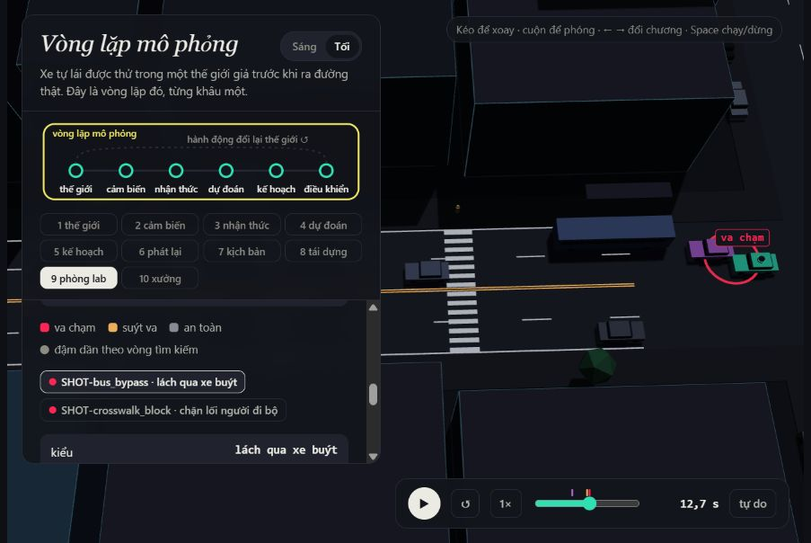
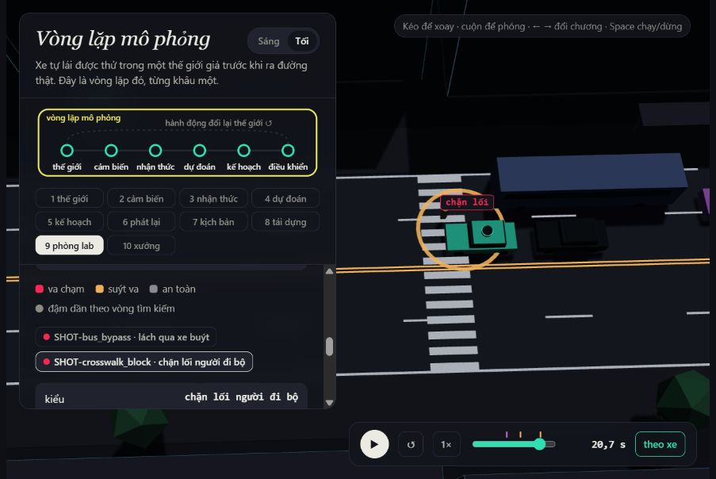
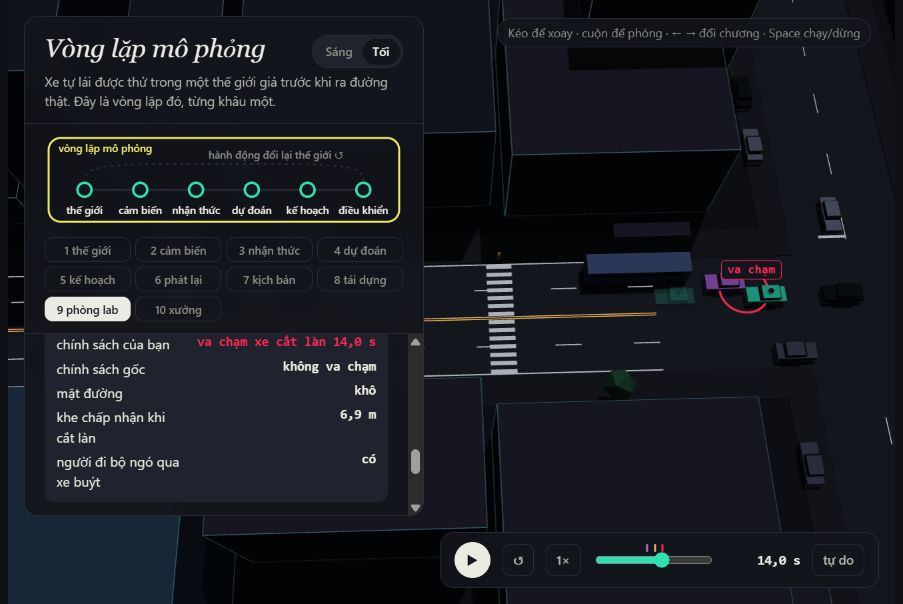
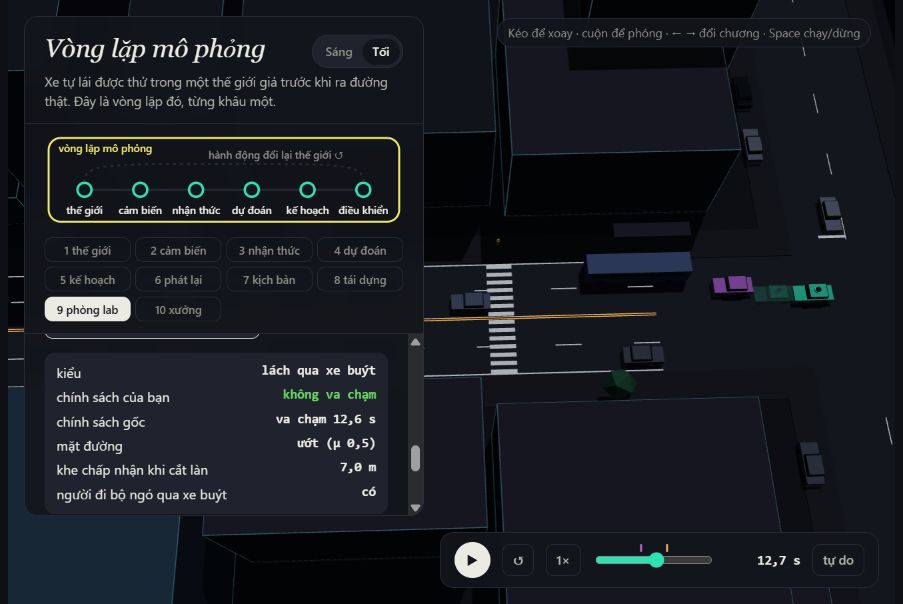

MSSV: 2A202602905

# Lab 11 · Scenario Forge — báo cáo hoàn chỉnh

Thị trấn **B** (`meta.json: _run.town`); seed MC `4182262453`, search `1091651144`, TEST công khai `1655211456` (`meta.json: seeds`). Tất cả bước dùng ngân sách mặc định, `quick=false`, không salt. MSSV chứa chữ được truyền nguyên vẹn qua `LAB11_MSSV`; xem `SUBMISSION.md`. Các trường JSON ghi dưới đây nằm trong `evidence/`. Số được làm tròn khi trình bày; file JSON giữ đủ độ chính xác.

## 1. Phát lại log có trung thực không?

`replay.json: n=400`, `dropped_human_crash_logs=1`, `n_used=399`, `crash_in_both=0`.

| Cách chạy | Thất bại | front | rear | side |
| --- | --- | --- | --- | --- |
| replay | 118 | 0 | 100 | 18 |
| reactive | 0 | 0 | 0 | 0 |

Nguồn: `replay.json: replay.crashes/contact`, `reactive.crashes/contact`. Xe bám đuôi trong log vẫn chạy theo quỹ đạo đã ghi với người lái; nó không biết planner phanh sớm hơn và không phanh đáp lại. Vì vậy va chạm rear khi replay có thể là artefact của cách đánh giá. Trong thế giới phản ứng, xe sau điều chỉnh theo khe và tốc độ thực. Không phải mọi side crash của replay đều là rear; chúng cũng có thể do xe cắt làn tiếp tục quỹ đạo đã ghi.

Ví dụ `replay.json: replay_only` scenario **5**, tiếp xúc `rear`: `observations.json: replay.event` ghi ego–TG tại 17.15 s; tốc độ ego trong log người lái 10.724 m/s, ego planner khi replay 0.805 m/s ở cùng khung. Chạy reactive không có thất bại ego, TTC nhỏ nhất 2.3908 s (`replay_only.min_ttc_reactive`). Các số ở `observations.json` là lần đọc quỹ đạo bổ sung, không thay số pipeline.

## 2. Kịch bản bất khả thi

| Luật loại | Căn cứ |
| --- | --- |
| π²·3.5/(2·cutDur²) > μg | Gia tốc ngang cực đại của chuyển làn cosine vượt lực bám |
| cutBrake > μg | Phanh sau nhập làn vượt gia tốc khả dụng do ma sát |
| pedV > 2.5 m/s | Giới hạn đi bộ của bài lab; không phải giới hạn sinh học cho chạy bộ |
| cutV ≤ 0 hoặc > 22 m/s | Loại tốc độ xe cắt làn ngoài miền đã định nghĩa |

| Cuộc săn | Bất khả thi | found (mọi kiểu gặp trong cuộc săn) |
| --- | --- | --- |
| bus_bypass | 4 | {"bus_bypass": 199} |
| cut_in | 9 | {"bus_bypass": 35} |
| crosswalk_block | 10 | {"crosswalk_block": 13} |
| rear_ended | 15 | {"crosswalk_block": 10} |

Nguồn: `hunt.json: <mode>.infeasible/found`. Cuộc săn sinh nhiều kịch bản bất khả thi nhất là `rear_ended`. Thời gian chuyển làn cực ngắn hay tốc độ/ma sát cực đoan làm điểm nguy hiểm lớn, nên nếu không lọc, CEM dễ bị hút vào các tình huống không thể tạo ra. Đếm chúng là thất bại sẽ phóng đại rủi ro của miền vật lý hợp lệ. `mc.json: infeasible=19`; bộ chạy không mô phỏng/đếm các mẫu đó là thất bại, nhưng mẫu số MC vẫn là số draw ban đầu theo quy ước pipeline.

## 3. Monte Carlo cho biết gì?

`mc.json: crashes=10`, `n=3000`, `p=0.00333333=0.333%`; Wilson 95% [`lo=0.00181161`; `hi=0.00612542`]. Với sai số tương đối ±20%, xấp xỉ chuẩn cho lập ngân sách cho n≈1.96²(1−p)/(0.2²p), tức khoảng **28,716** draw; quy tắc hiếm 96/p≈**28,800**, khoảng 9.6 lần ngân sách hiện tại. Đây là dự toán, không thay khoảng Wilson khi đếm ít sự kiện.

| Kiểu | k | Wilson 95% |
| --- | --- | --- |
| bus_bypass | 10 | [0.00181161; 0.00612542] |
| cut_in | 0 | [0; 0.0012789] |
| crosswalk_block | 0 | [0; 0.0012789] |
| rear_ended | 0 | [0; 0.0012789] |
| other | 0 | [0; 0.0012789] |

Nguồn: `mc.json: per_mode.<mode>.k/lo/hi`. Các kiểu k=0 phải báo **chưa thấy, cận trên như bảng**, không kết luận xác suất bằng 0. Đối với IS hỗn hợp phòng thủ, dùng cận `3/(0.2n)`, không dùng `3/ESS`.

## 4. Importance sampling, ESS và suy biến

| Seed | Kiểu | p hoặc cận trên | hits | ESS | top_share | se |
| --- | --- | --- | --- | --- | --- | --- |
| 0 | bus_bypass | 0.000191923 | 33 | 125.475 | 0.463635 | 9.39901e-05 |
| 0 | cut_in | chưa thấy; U95=0.025 | 0 | 130.243 | 0 | 0 |
| 0 | crosswalk_block | 8.38751e-07 | 40 | 133.66 | 0.288681 | 3.64572e-07 |
| 0 | rear_ended | chưa thấy; U95=0.025 | 0 | 126.35 | 0 | 0 |
| 1 | bus_bypass | 0.000364791 | 39 | 111.86 | 0.208889 | 0.000129361 |
| 1 | cut_in | chưa thấy; U95=0.025 | 0 | 121.864 | 0 | 0 |
| 1 | crosswalk_block | 1.50134e-06 | 44 | 121.955 | 0.402987 | 7.5712e-07 |
| 1 | rear_ended | chưa thấy; U95=0.025 | 0 | 115.09 | 0 | 0 |
| 2 | bus_bypass | 0.000769236 | 38 | 125.558 | 0.66377 | 0.000527219 |
| 2 | cut_in | chưa thấy; U95=0.025 | 0 | 131.039 | 0 | 0 |
| 2 | crosswalk_block | 5.70511e-07 | 35 | 125.667 | 0.299882 | 2.21817e-07 |
| 2 | rear_ended | chưa thấy; U95=0.025 | 0 | 120.023 | 0 | 0 |

Nguồn: `estimate.json: seeds[i].per.<mode>.p/hits/ess/top_share/se/upper_zero_hits`. Ước lượng là mean(w·y), không chia cho tổng trọng số. q=0.8q_CEM+0.2p nên w≤5. ESS đo độ phân tán trọng số toàn bộ mẫu; top_share là phần ước lượng một mẫu chiếm. top_share>0.5 nghĩa là hơn nửa kết quả do một mẫu mang, làm CI chuẩn khó đáng tin. top_share nhỏ cũng không chứng minh q đã phủ mọi vùng thất bại.

| Seed | total | Khoảng xấp xỉ |
| --- | --- | --- |
| 0 | 0.000192762 | [8.53998e-06; 0.00165588] |
| 1 | 0.000366292 | [0.00011274; 0.00189874] |
| 2 | 0.000769806 | [0; 0.00308205] |

Tổng qua seed thay đổi từ 0.000192762 đến 0.000769806, tỷ số max/min=3.994; trung vị=0.000366292 so với MC 0.00333333. Đây là so sánh bất định, không chọn seed đẹp nhất. MC điểm cao hơn trung vị IS 9.100 lần: các seed không cho một con số ổn định và không đồng thuận tốt với MC. Không giải thích sai lệch này bằng cách chọn seed thuận mắt. CEM có thể phủ tốt một nhánh hiếm nhưng bỏ sót nhánh phổ biến hơn; trọng số lý thuyết không chệch không đảm bảo một lần chạy hữu hạn đủ đại diện. Các trường top_share>0.5: seed 2, bus_bypass: 0.66377. Khoảng của total do bộ chạy tổng hợp là xấp xỉ, không tự chứng nhận các kiểu zero-hit đã biến mất; cần đọc cận riêng từng kiểu.

Để so ngân sách với độ chính xác IS, dùng n_MC≈p(1−p)/se² cho từng ước lượng có hits và se>0; các con số sau phụ thuộc chính p ước lượng, không phải chứng minh hiệu quả trên xác suất thật:

| Seed | Kiểu | n MC cùng SE (xấp xỉ) |
| --- | --- | --- |
| 0 | bus_bypass | 21721 |
| 0 | crosswalk_block | 6310547 |
| 1 | bus_bypass | 21792 |
| 1 | crosswalk_block | 2619086 |
| 2 | bus_bypass | 2766 |
| 2 | crosswalk_block | 11595076 |

`estimate.json: budget=16800` = 4×(8×300+3×600) draw, gồm săn và đo; MC có 3.000 draw. Chi phí mô phỏng thực còn phụ thuộc mẫu bất khả thi. `other` lấy từ MC: k=0, n=3000, cận hi=0.0012789 (`estimate.json: other`). Không săn other vì nó gom các cơ chế chưa định danh, chưa có một điểm nguy hiểm đặc thù; bỏ nó sẽ làm tổng thiếu một phần tập thất bại.

## 5. Các kiểu thất bại và hình 3D

| Kiểu tìm được trong cloud | Số điểm thất bại | Ví dụ t (s) | Đối tượng |
| --- | --- | --- | --- |
| bus_bypass | 234 | 12.6 | C2 |
| crosswalk_block | 23 | 20.65 | P1 |

Nguồn số điểm: `cloud.json`, lọc `out=crash` và `mode`; nguồn khung/đối tượng: `observations.json: <mode>.event`. `report_viewer.json` chứa đúng các ví dụ ảnh. Ảnh lấy ở khung ngay sau event (chênh 0.05 s) để marker hiện rõ; nhãn thời gian của viewer làm tròn một chữ số.

**bus_bypass**: Xe C2 đang vượt xe buýt đỗ, lấn vào làn ego; C2 ở trước x=112 m và chạy chậm dưới 6 m/s. Ego nhận nó làm xe trước quá muộn nên tiếp xúc. Ví dụ t=12.60 s; đối tượng x=95.707 m, v=0.453 m/s, ego v=4.045 m/s; kind=`contact`.

Trong ví dụ này, C2 được nhận làm leader: t=11.95 s (`observations.json: bus_bypass.first_c2_leader_t`); C2 chậm lại trước bus và tìm khe để vào làn ego. Chênh lệch giữa nhận leader và event thể hiện thời gian planner còn lại để phanh.

**crosswalk_block**: P1 đi ra sau xe buýt; ego phanh nhưng thân xe dừng chắn vạch. P1 đứng lại thay vì đi xuyên thân xe. Sự kiện block được tính là thất bại dù không phải tiếp xúc vật lý. Ví dụ t=20.65 s; đối tượng x=122.000 m, v=0.000 m/s, ego v=0.000 m/s; kind=`block`.

Người đi bộ không ngó qua bus (`params.pedLook=0`); khung đầu tiên đồng thời P1 đang đi và planner thấy P1 là t=15.60 s (`observations.json: crosswalk_block.first_visible_moving_ped_t`). P1 đợi khe mà mình nhìn thấy, ego có chế độ thận trọng khi tầm nhìn bị che; bus che tầm nhìn làm hai quyết định không có cùng thông tin.

Chưa tìm được trong các điểm săn lưu: cut_in, rear_ended. Điều này chỉ nói về không gian, score, seed và ngân sách đã thử; không chứng minh không thể xảy ra. Cận zero-hit trong IS/MC mới là cách định lượng giới hạn. Một CEM chung dễ co về basin dễ tối ưu nhất (ví dụ lách xe buýt), mất các cơ chế khác như chặn vạch. Bảng found ở câu 2 cho thấy ngay cả một cuộc săn nhắm một kiểu vẫn có thể gặp kiểu khác; cần score và proposal riêng.

## 6. Sửa planner: chọn trên TRAIN, báo cáo trên TEST

`fix.json: chosen.policy = {"cutinLat": 3.0}`. Giữ nguyên danh sách ứng viên của repo, không thêm ứng viên theo kết quả TEST. choose_policy chọn fail_hi TRAIN nhỏ nhất trong các hàng có progress≥95% baseline, hòa thì lấy progress lớn hơn. TEST dùng seed mới và săn lại dưới từng policy.

| Tập / policy | fail | fail_hi_seen | fail_hi | progress (m) | harsh (frame/chuyến) | unseen |
| --- | --- | --- | --- | --- | --- | --- |
| baseline TRAIN | 0.000495668 | 0.000917831 | 0.000917831 | 209.839 | 9.48828 | — |
| chosen TRAIN | 2.29818e-05 | 6.66839e-05 | 6.66839e-05 | 209.825 | 9.02344 | bus_bypass |
| baseline TEST | 0.00224083 | 0.00424281 | 0.00552171 | 213.688 | 8.26433 | — |
| chosen TEST | 1.14757e-06 | 2.12396e-06 | 0.038781 | 213.679 | 7.69667 | bus_bypass |

Nguồn: `fix.json: baseline_train/chosen/baseline_test/chosen_test` và các trường tương ứng. harsh đếm **khung** a<−3 m/s², không phải số pha phanh độc lập; quãng đường bị cắt tại thất bại đầu tiên.

Giảm quãng đường TRAIN 0.006%; TEST 0.004%. fail_hi_seen chỉ cộng kiểu có hits; fail_hi TEST còn cộng 3/(0.2×400)=0.0375 cho mỗi kiểu zero-hit và Wilson cho va chạm ngoài hai kiểu được săn. Do đó bản sửa không thấy bus_bypass trong mẫu vẫn có thể có fail_hi lớn hơn fail điểm của bản gốc. Không thể chứng nhận xác suất nhỏ chỉ bằng vài trăm mẫu.

| Ứng viên TRAIN | fail | fail_hi | progress |
| --- | --- | --- | --- |
| {"cautionV": 5.0} | 0.000682272 | 0.00174412 | 172.71 |
| {"cautionV": 6.5} | 0.000394019 | 0.000832218 | 195.67 |
| {"cautionV": 6.0} | 4.25412e-05 | 7.13332e-05 | 186.989 |
| {"cautionV": 9.0} | 0.00110973 | 0.00210036 | 227.484 |
| {"cautionV": 8.5} | 0.00177612 | 0.00342911 | 223.356 |
| {"cutinLat": 2.6} | 4.73121e-05 | 0.000122069 | 209.832 |
| {"cutinLat": 3.0} | 2.29818e-05 | 6.66839e-05 | 209.825 |
| {"cutinLat": 3.3} | 2.29818e-05 | 6.66839e-05 | 209.817 |
| {"T": 2.0} | 0.000413525 | 0.000853155 | 200.825 |
| {"cutinLat": 3.0, "cautionV": 6.5} | 2.5674e-05 | 6.96819e-05 | 195.631 |
| {"cutinLat": 3.0, "cautionV": 7.0} | 2.30594e-05 | 6.67612e-05 | 203.25 |
| {"cutinLat": 2.6, "cautionV": 7.0, "pedBuffer": 3.5} | 2.30594e-05 | 6.67612e-05 | 203.264 |

Nguồn: `fix.json: table`. Giảm cautionV có thể khiến xe sau phải phanh mạnh hơn; tăng cutinLat có thể làm ego nhường xe làn bên sớm và thay đổi khe xe C2 chấp nhận. Cơ chế này không đơn điệu: planner đổi hành vi thì các tác nhân reactive cũng đổi. Chỉ coi một núm phản tác dụng khi hàng TRAIN cho thấy kết quả, không suy diễn rằng mọi thay đổi nghe an toàn đều tệ hơn.

Ví dụ TRAIN có fail cao hơn baseline: `{"cautionV": 5.0}`, fail=0.000682272 so với 0.000495668. Đây là bằng chứng trên TRAIN; không đủ quy hoàn toàn cho một cơ chế nếu chưa chạy thí nghiệm đối chứng.

**Đối chứng cùng kịch bản TRAIN:** `caution_counterexample.json: draw_index=166`, seed=1091651155. Với cautionV=7.5, C2 bắt đầu lấn ngang lúc 17.25 s, sau khi bus rời lúc 15.94 s; baseline không có event ego. Với cautionV=5, C2 lấn từ 11.05 s và ego nhận C2 làm leader lúc 13.45 s, rồi va chạm 13.95 s. Khi đó ego gốc đã ở x=101.582 m, ego thận trọng mới ở x=91.220 m. Đi chậm thay đổi khe mà C2 chấp nhận, nên xe khác lấn vào sớm hơn; không phải chỉ giảm tốc ego trên một quỹ đạo C2 cố định. Đây là ca phản tác dụng có thật trong mô phỏng. Đồng thời `fix.json: table[0].bus_bypass.top_share=0.759534` cho thấy ước lượng TRAIN của núm này bị một mẫu chi phối; không suy ra xác suất thật tăng chắc chắn chỉ từ fail điểm và CI chồng lấn.

Ví dụ `observations.json: comparison`: baseline thất bại kiểu bus_bypass tại 12.60 s, policy được chọn không có event ego. Nạp `comparison_viewer.json`: xe đặc là bản sửa, bóng mờ là bản gốc.

## 7. Từ mô phỏng ra đường thật

| Giả định quan trọng ở thị trấn B | Dữ liệu thay thế cụ thể | Hướng sai lệch dự kiến |
| --- | --- | --- |
| cutGap lognormal, median 12 m | Quỹ đạo và kích thước xe từ video drone được hiệu chuẩn tại đoạn phố có xe buýt; inD là ví dụ dữ liệu quỹ đạo giao lộ để xây quy trình đo. Đo khe trước/sau tại thời điểm bắt đầu nhập làn, gồm cả lần từ chối khe. | Nếu người thật chấp nhận khe nhỏ hơn thì mô hình thường đánh giá thấp cut-in/bus_bypass; cần kiểm tra tương tác reactive để xác nhận. |
| pedLook Bernoulli 0.85; pedGap lognormal median 4.5 s | Thu thập video tại bến xe buýt sát vạch, gán nhãn vị trí đầu/thân, bước ra nhìn, bus occlusion và thời gian xe đến. Có danh sách cả lượt chờ lẫn lượt qua; không lấy orientation đơn lẻ làm bằng chứng chắc chắn về gaze. | Nếu ít người nhìn qua xe buýt hơn hoặc chấp nhận khe ngắn hơn thì dự kiến crosswalk_block tăng. |
| wet=0.30, μwet=0.5 và μdry=0.8 | Tần suất mặt đường ướt từ log camera/mưa theo đúng tuyến và giờ; đo deceleration/ABS/IMU trên đường thử ở tốc độ tương ứng, kết hợp đo ma sát mặt đường theo FHWA. | Nếu μ thật thấp hơn hoặc tỷ lệ ướt cao hơn, khoảng dừng tăng và rủi ro thường bị đánh giá thấp; số skid chuẩn hóa không tự bằng μ của mọi lốp/tốc độ. |

Đây là kế hoạch hiệu chỉnh, chưa thu dữ liệu thật cho bài này. Nguồn dữ liệu/quy trình: [bài báo inD của tác giả](https://arxiv.org/abs/1911.07602), [FHWA locked-wheel tester](https://infotechnology.fhwa.dot.gov/locked-wheel-tester/). inD cung cấp quỹ đạo người tham gia giao thông từ drone; cần kiểm tra miền dữ liệu trước khi dùng cho phố có bus ở đây. Các hướng sai lệch là giả thuyết cơ chế, không phải hệ số đã đo.

## 8. Giới hạn

1. Chỉ một đoạn phố, 24 s và 16 tác nhân nền; không đo rủi ro cả mạng đường, đường cao tốc hoặc nhiều giờ chạy.
2. Xe khác dùng IDM/gap acceptance quy tắc, người đi bộ theo thời gian-khe và vật cản; chưa có phân tâm, dự báo ý định đa dạng hay phân phối được fit từ người thật.
3. Planner có state chính xác với che khuất hình học, chủ yếu do bus trong thế giới nền; không mô phỏng đầy đủ lỗi detection, tracking, trễ cảm biến hay lỗi định vị. Hazard oracle có kiểm tra đường nhìn đối với thân xe.

Nếu thêm một tuần: thu dữ liệu hiệu chỉnh ba prior ở câu 7, chạy sensitivity trước khi tune, tăng ngân sách độc lập cho kiểu zero-hit (muốn cận 10⁻³ với beta=0.2 cần khoảng 15.000 draw/kiểu), thử trễ cảm biến và planner có dự đoán chuyển ngang của xe đạp. Không dùng TEST hiện tại để chọn lại policy rồi báo như holdout.

## 9. Rắc rối riêng: xe đạp chuyển ngang từ làn ngoài

Cảnh được dựng trong chương 10: H0 ở x=65 m, làn E2, d=0.7 m, v=5.5 m/s; khi ego còn cách 12 m thì lạng trái 3.4 m trong 2.7 s. Tình huống tương ứng một người đi xe đạp chuyển hẳn khỏi vùng cản mép đường. Không khẳng định ổ gà nhỏ khiến người lái lệch 3.4 m. Planner gốc chỉ nhận xe trong corridor ngang cutinLat=2.15 m, nên có thể phản ứng trễ với ý định chuyển vào làn.

`mine.json: exact.planner = [["ego", "H0", 13.85]]`; `accepted=0.992=99.200%; infeasible=12`. Không có overlap khi mở cảnh; giới hạn và space được kiểm tra bằng studio.

| Trường space | Khoảng | Căn cứ |
| --- | --- | --- |
| h0_x | 45–85 m | ±20 m quanh cảnh x=65; sweep thiết kế riêng thấy va chạm tránh được ở x=45,65,85 khi trig=12 |
| h0_v | 4.8–6 m/s | 17.28–21.6 km/h, nằm trong dải tốc độ thiết kế thông thường 16–24 km/h của NACTO |
| h0_d / h0_swerve | 0.5–0.9 m / 3.2–3.6 m | Tâm làn cách 3.5 m; tâm bike cuối z=2.15–2.95, vào corridor thân ego |
| h0_swDur | 2.6–3 s | a_lat tối đa π²·3.6/(2·2.6²)=2.628 m/s² <3 và <0.5g |
| h0_trig | 10–14 m | Lân cận điểm kích hoạt 12 m; biên kiểm thử engineering phản ứng muộn |

Nguồn đầy đủ: `hazard.json: why`, [NACTO design controls](https://nacto.org/publication/urban-bikeway-design-guide/designing-bikeways-for-all-ages-and-abilities/design-controls-for-bicycle-facilities/), [NHTSA bicycle safety](https://www.nhtsa.gov/road-safety/bicycle-safety). Các nguồn hỗ trợ tốc độ/để khoảng trống; không cung cấp tần suất lạng hay phân phối space. Uniform độc lập là thiết kế stress test công khai.

| Policy | n hợp lệ | crashes | avoidable | unavoidable | unattributed | low_speed | avoidable_foreknown | overlap_at_start | P lỗi \| hazard, Wilson 95% |
| --- | --- | --- | --- | --- | --- | --- | --- | --- | --- |
| baseline | 1488 | 754 | 750 | 4 | 0 | 22 | 754 | 0 | 0.504032 [0.47865; 0.529394] |
| chosen | 1488 | 1085 | 1079 | 6 | 0 | 584 | 1085 | 0 | 0.725134 [0.701892; 0.747217] |

Nguồn: `mine.json: baseline/chosen` và các trường tương ứng. **avoidable**: cùng prefix planner, phanh tối đa ngay khi hazard đã bắt đầu và nhìn thấy thì tránh được mọi thất bại ego. **unavoidable**: phép thử phanh đó vẫn thất bại; không kết luận mọi phương án đánh lái đều bất lực. **unattributed**: thất bại không quy cho hazard, không chỉ đơn thuần là va chạm trước khi hazard bắt đầu. low_speed (<1 m/s) là cờ chồng lên các loại, không cộng lần thứ hai. avoidable_foreknown bỏ giới hạn nhìn thấy; chênh lệch với avoidable biểu thị cái giá che khuất.

Chuẩn oracle lạc quan vì phản ứng tức thì, biết hazard ngay khi thấy và phanh tối đa: có thể đếm nhiều hơn số va chạm planner thực tế tránh được. Ngược lại chỉ thử phanh, không đánh lái, làm nó bỏ sót ca tránh được bằng hướng lái khác. Hai tác động ngược nhau nên không coi đây là ground truth lỗi planner tuyệt đối.

`hazard.json: exposure=1.0` **là giao thức thử**: cài một H0 mỗi chuyến, không phải tần suất giao thông ngoài đời. `mine.json: baseline.per_trip=0.504032` chỉ áp dụng tuyến thử cố ý phơi nhiễm. Với exposure thực e chưa biết, f_bike(e)=e·P(avoidable | hazard). Không dùng exposure=1 để tuyên bố bike nguy hiểm hơn trong thị trấn thật.

Trung vị IS bus_bypass=0.000364791 (`estimate.json: seeds[].per.bus_bypass.p`); hai tần suất bằng nhau khi e*=p_bus/p_bike=0.000723745. Đây là ngưỡng sensitivity trên các prior giả định; muốn biết phía nào lớn hơn cần đo e ngoài đời.

Nếu thay p_bus bằng MC bus_bypass=0.00333333, ngưỡng tương ứng là e*=0.00661333. Sự chênh lệch giữa hai ngưỡng phản ánh bất ổn IS ở câu 4; không chọn một ngưỡng làm sự thật.

| Exposure giả định cho sensitivity, không phải dữ liệu đo | f_bike / chuyến |
| --- | --- |
| 0.001 | 0.000504032 |
| 0.01 | 0.00504032 |
| 0.1 | 0.0504032 |
| 1 | 0.504032 |

Ảnh ở 13.9 s, ngay sau khung tiếp xúc 13.85 s của cảnh cố định (thanh viewer bước 0.05 s, nhãn làm tròn một chữ số). Chưa có thử lái do người dùng thực hiện; không báo kết quả người lái. Cách sửa: tăng cutinLat lên 3.0 đã được thử ở E và còn làm tình huống này tệ hơn, nên không coi tăng corridor là lời giải đã được chứng minh. Có thể sàng v0/T trên một TRAIN dành riêng cho hazard, với kiểm tra rear-end/progress, nhưng không chọn lại theo TEST vừa báo. Hướng sửa logic cụ thể là dự báo vận tốc ngang/ý định chuyển làn, tính giao cắt swept body với ego trong vài giây tới, phanh sớm và kiểm tra vị trí dừng nằm ngoài quỹ đạo bike; kiểm tra xe bám đuôi để tránh chỉ chuyển lỗi sang phía sau. Không sửa lõi avsim trong bài nộp.

Bản sửa ở E **không tổng quát hóa tốt sang hazard này**: P(avoidable | hazard) tăng từ 50.403% lên 72.513% (`mine.json: baseline.p/chosen.p`); chênh lệch 22.110 điểm phần trăm. Va chạm low_speed đổi từ 22 sang 584. Nhiều event ở tốc độ thấp là bike tiến vào thân xe đang chờ, không phải ego lao vào bike. Phanh đến tốc độ thấp chưa đảm bảo thân xe dừng ở vị trí tránh được quỹ đạo ngang. Một fix tốt trên hai kiểu được săn không tự chứng minh an toàn trên cơ chế mới. Các Wilson trong bảng là khoảng biên riêng; không dùng công thức hai mẫu độc lập cho chênh lệch vì hai policy chạy cùng các kịch bản.

## Kiểm tra bổ sung và tái lập

10 TODO đã triển khai theo docstring. 31 test công khai, 10 test parity và 3 test biên bổ sung (batch với xe đạp mới, thứ tự phân loại/biên 112 m và 6 m/s, CEM tie ổn định) được kiểm tra. Kết quả kiểm tra cuối nằm trong `evidence/validation.json`. Lõi, seed, phân phối và ứng viên gốc giữ nguyên. Rubric không có bonus riêng; kiểm tra biên, script tái lập và sensitivity exposure là phần mở rộng, không tự nhận điểm.
